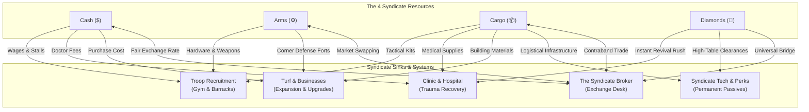

# BLACK MARKET - MULTI-RESOURCE SYNDICATE ECONOMY SPECIFICATION
**Canonical Architecture, Mathematical Model & Migration Blueprint**

---

## 1. Executive Summary & Problem Analysis

### 1.1 The Failure of the Single-Resource Model
In the legacy implementation, the game revolved entirely around a single resource: **Cash**.
- **Market arbitrage was the only primary loop**: Buy low, sell high, grind cash.
- **Cash bought everything**: Troop training, hospital recovery, turf upgrades, bribes, travel, and debt service all drained the same currency.
- **The "Clean Cash" illusion**: Clean cash was simply dirty cash minus a 20% laundering fee. It did not create a new strategic dimension; it was merely an accounting tax.
- **The degenerate gameplay result**:
  - In the early game, if cash was tight, the player was paralyzed across all systems simultaneously (could not heal, could not recruit, could not travel).
  - In the mid-to-late game, once a profitable trading or smuggling route was established, friction evaporated. The player could instantly recruit thousands of elite soldiers and buy out entire districts solely with money, turning the game into an Amazon delivery spreadsheet rather than a criminal syndicate struggle.

### 1.2 The Multi-Resource Principle
Modern strategic syndicate games (such as *The Grand Mafia*, *Mafia City*, and classic territory builders) succeed because they separate **Liquid Capital**, **Military Industrial Capacity**, **Logistics & Infrastructure**, and **High-Table Leverage**.

By establishing four distinct resources with dedicated production loops, the game achieves:
1. **Strategic Dimension**: Having $1,000,000 in cash does not mean you have the munitions to raise an army or the materials to build a fortified front.
2. **Specialized District Value**: Conquering an industrial ward matters because you need its machine shops for Arms. Conquering a harbor matters because you need its warehouses for Cargo.
3. **Anti-Starvation Safety Valve**: An in-game Syndicate Broker allows exchanging surplus resources or spending rare Diamonds so a player is never dead-ended by bad RNG.

---

## 2. The Four Core Syndicate Resources

| Resource | Symbol | Thematic Identity | Role in Gameplay | Storage & Limits |
|---|---|---|---|---|
| **Cash** | `$` | Liquid Street Currency | Everyday transactions, travel fares, market stock, dealer bribes, daily upkeep | Carried in wallet (risk of theft/loss), stashed in Safehouse lockbox, or laundered into Bank |
| **Arms** | `⚙` | Munitions & Weapon Hardware | Military recruitment, weapon crafting, corner defensive barricades | Stored in Armory stockpile (capped by Safehouse Armory tier) |
| **Cargo** | `📦` | Contraband Crates & Building Materials | Upgrading businesses, expanding facilities, clinic trauma supplies | Stored in Warehouse depots (capped by held turf & safehouse capacity) |
| **Diamonds** | `💎` | Rare Syndicate Bullion & Sovereign Favor | Instant clinic speed-ups, high-tier syndicate investments, emergency bail, Broker universal bridge | Untouchable syndicate ledger (permanent, immune to muggings/raids) |

---

## 3. Resource Inflows: How Resources Are Acquired

### 3.1 Passive Generation (Daily Morning Turf Yields)
Every morning, corners and businesses held by the player generate a morning supply drop based on the district's economic specialization.

```
+-------------------------------------------------------------------------+
|                        DAILY MORNING SYNDICATE DROP                     |
+--------------------+----------------------------------------------------+
| District Type      | Daily Production Focus                             |
+--------------------+----------------------------------------------------+
| Commercial / Hub   | High Cash yields + Commercial goods                |
| (Downtown, Ginza)  | (Rent and protection payments from luxury retail)  |
+--------------------+----------------------------------------------------+
| Industrial / Slums | High Arms yields (⚙)                               |
| (Warehouse Row)    | (Illicit machine shops, scrap foundries, munitions)|
+--------------------+----------------------------------------------------+
| Maritime / Port    | High Cargo yields (📦)                             |
| (North Port, Docks)| (Sealed freight crates, raw contraband shipments)   |
+--------------------+----------------------------------------------------+
| Citadel / Hall     | High-tier Cash + Occasional Diamond tribute (💎)   |
| (Strongholds)      | (Syndicate council dividends, political influence) |
+--------------------+----------------------------------------------------+
```

- **Corner Rent & Production**:
  - Each corner definition (`CornerDef`) gains resource production fields: `daily_cash`, `daily_arms`, `daily_cargo`.
  - Holding all corners in a district activates a **District Monopoly Bonus** (+25% resource yield across that entire district).

### 3.2 Active Generation (Player Actions & Contracts)

#### A. Cash ($)
- **Market Arbitrage**: Buying commodity goods low in one district and selling high in another.
- **Customer Orders & Errands**: Completing delivery gigs for street clients.
- **Protection Rackets**: Extorting independent corner sellers.

#### B. Arms (⚙)
- **Battlefield Salvage**: Defeating rival invading columns or capturing enemy corners recovers dropped firearms, converting enemy casualties into raw Arms:
  $$\text{Arms Salvaged} = \text{Enemy Casualties} \times \text{Salvage Multiplier (0.15 - 0.30)}$$
- **Rook's Armory & Weapon Scrapping**:
  - Rook sells bulk munitions shipments for Cash.
  - Players can dismantle obsolete, damaged, or surplus weapons into Arms.
- **Gunrunning Errands**: Accepting high-risk missions from the Black Hand to intercept corrupt police munitions convoys.

#### C. Cargo (📦)
- **Voronin's Smuggling Crates (`smuggling.gd`)**: Delivering sealed crates from Pier 9 across the map is the primary active source of Cargo boxes (rewarding 15 to 40 Cargo per delivery in addition to cash).
- **Ambush Counter-Seizure**: Defeating highwaymen and rival hijackers yields their supply vehicles, securing their cargo.
- **Contraband Recycling**: Dismantling expired, confiscated, or unsellable bulk market inventory at the safehouse into raw Cargo building supplies.

#### D. Diamonds (💎) - The Rare Strategic Asset
Because Diamonds serve as the universal accelerator and conversion bridge, they are intentionally scarce and earned through milestone achievements:
1. **High-Stakes Heists (`heists.gd`)**:
   - Cracking major security targets (Casino Vault, Diamond Exchange, Federal Armored Train) rewards a vault payout of **10 to 30 Diamonds** alongside liquid cash.
2. **District Liberation (Boss Conquests)**:
   - Conquering all corners in a contested district and defeating the ruling rival boss (e.g. Vex, Jackal, Kuroda) awards a **Syndicate War Chest** containing **25 to 50 Diamonds**.
3. **Daily Syndicate Checklist (`daily_tasks.gd`)**:
   - Completing all 10 daily tasks for the morning awards a milestone completion reward of **5 to 10 Diamonds**.
4. **Campaign & Debt Milestones**:
   - Covering a weekly debt payment without missing deadlines awards a **5 Diamond** syndicate trust bonus.
   - Paying off the Shark completely awards **50 Diamonds**.
5. **Hana's Encrypted Caches (Street Encounters)**:
   - Hana periodically cracks encrypted GPS coordinates of a rival boss's private stash, allowing a raid for 5 to 15 hidden Diamonds.

---

## 4. Resource Outflows: Sinks & Systems Integration



### 4.1 Troop Recruitment & Training (`Gym`, `Army`)
Recruiting soldiers requires physical armaments and gear, not just paper money:
- **Lunatics (Tier 1)**:
  - *Cost per 1,000*: $1,000 Cash + 0 Arms.
  - *Concept*: Unarmed street brawlers, meatshields, cheap to hire.
- **Guards (Tier 2)**:
  - *Cost per 1,000*: $4,000 Cash + 250 Arms.
  - *Concept*: Disciplined soldiers equipped with handguns, riot vests, and shotguns.
- **Black Hand (Tier 3)**:
  - *Cost per 1,000*: $20,000 Cash + 1,000 Arms + 200 Cargo.
  - *Concept*: Midnight Rabbit's elite paramilitary death squad, requiring military hardware and specialized tactical kits.

### 4.2 Casualty Treatment & Clinic (`Hospital`)
When men fall in combat, they enter the Wounded pool up to hospital bed capacity:
- **Standard Recovery**:
  - Requires **Cash + Cargo** (antibiotics, trauma packs, surgical kits).
  - Rate: 10 Cargo + $500 Cash per 1,000 wounded fighters treated.
- **Diamond Emergency Rush**:
  - During an active enemy counter-invasion, the player cannot wait for standard recovery.
  - Spending **Diamonds** (e.g. 5 Diamonds per 5,000 troops) instantly revives wounded men back into the Active battle-ready pool with zero recovery delay.

### 4.3 Real Estate, Fronts & Upgrades (`Businesses`, `Safehouse`)
- **Acquiring a Business**: Requires Cash (purchase deed) + Street Cred rank.
- **Upgrading Business Levels (Level 1 to 5)**:
  - Requires **Cash + Cargo** (renovation materials, industrial freezers, counterfeit printing machinery).
  - *Example*: Upgrading a Nightclub from Level 2 to Level 3 costs $25,000 Cash + 80 Cargo boxes.
- **Corner Defensive Barricades**:
  - Posting garrisons is improved by building fortifications.
  - Fortifying a corner costs **Cash + Arms** (sandbags, reinforced gates, weapon emplacements), giving defender units a +20% defense bonus during rival assaults.

---

## 5. The Syndicate Broker (The Universal Exchange)

To ensure that the player is never permanently deadlocked by a deficit in one resource while overflowing with another, the **Broker Desk** operates at the Safehouse:

### 5.1 Resource Swapping Rules
- **Arms to Cargo / Cargo to Arms**:
  - Base conversion ratio: $1 \text{ Cargo} \leftrightarrow 2 \text{ Arms}$.
  - Broker Transaction Fee: 15% syndicate cut (reduced by Hana's trade skills).
- **Diamond Conversion (The Universal Bridge)**:
  - Diamonds can be converted into any basic resource at standard exchange rates:
    - $1 \text{ Diamond} \rightarrow \$2,000 \text{ Cash}$
    - $1 \text{ Diamond} \rightarrow 50 \text{ Arms}$
    - $1 \text{ Diamond} \rightarrow 25 \text{ Cargo}$
  - Basic resources cannot be converted into Diamonds (preserving Diamond rarity and anti-inflation).

---

## 6. Mobile HUD & User Experience Integration

### 6.1 Top Header Ribbon (`hud_bar.tscn`)
The current top bar displays only Cash, Clean Cash, and Debt. It is restructured into a responsive mobile syndicate resource header:

```
+-------------------------------------------------------------------------+
| [$ 14,250]   [⚙ 620]   [📦 185]   [💎 35]   |  Day 6 [Noon]  |  [Heat 24%] |
+-------------------------------------------------------------------------+
```

- **Visual Contrast & Design**:
  - `Cash ($)`: Standard green/cream palette.
  - `Arms (⚙)`: Gunmetal steel blue/grey.
  - `Cargo (📦)`: Industrial amber/gold crate icon.
  - `Diamonds (💎)`: Sharp brilliant cyan diamond.
- **Tap-to-Inspect Drawer**:
  - Tapping any resource chip slides open a clean inspect sheet showing:
    - Current balance.
    - Safehouse storage capacity limit.
    - Daily morning net production (+Inflow / -Upkeep).
    - Quick "Exchange" button linking directly to the Broker desk.

---

## 7. Migration & Codebase Cleanup Roadmap

### Phase 1: Core Domain Model (`RunState`)
- [ ] Add `arms: int`, `cargo: int`, and `diamonds: int` to [`run_state.gd`](file:///root/termux/games/godot/project/scripts/core/run_state.gd).
- [ ] Update `to_dict()` and `from_dict()` serialization to preserve backward compatibility (defaulting legacy saves to initial starting balances).
- [ ] Add starting balances for a new run: $2,000 Cash, 100 Arms, 30 Cargo, 10 Diamonds.

### Phase 2: HUD & Visual Representation
- [ ] Update [`hud_bar.tscn`](file:///root/termux/games/godot/project/ui/chrome/hud_bar.tscn) and [`hud_bar.gd`](file:///root/termux/games/godot/project/ui/chrome/hud_bar.gd) with dedicated resource counters.
- [ ] Bind tweening and update signals when balances change.

### Phase 3: Systems Wiring & Balance Calibration
- [ ] **Gym**: Update [`gym.gd`](file:///root/termux/games/godot/project/scripts/systems/social/gym.gd) to check Arms for Guards and Arms + Cargo for Black Hand.
- [ ] **Hospital**: Update [`hospital.gd`](file:///root/termux/games/godot/project/scripts/systems/war/hospital.gd) to support Cargo trauma supplies and Diamond instant recovery.
- [ ] **Smuggling**: Update [`smuggling.gd`](file:///root/termux/games/godot/project/scripts/systems/economy/smuggling.gd) to deliver Cargo crates upon successful route completion.
- [ ] **War & Conquest**: Update corner captures and daily morning cuts in [`corners.gd`](file:///root/termux/games/godot/project/scripts/systems/war/corners.gd) to award district-specific resources.
- [ ] **Heists & Tasks**: Update [`heists.gd`](file:///root/termux/games/godot/project/scripts/systems/economy/heists.gd) and [`daily_tasks.gd`](file:///root/termux/games/godot/project/scripts/systems/social/daily_tasks.gd) to award Diamond payouts.

### Phase 4: Foundational Code Cleanup
- [ ] Clean up redundant React/DOM web patterns and procedural bottom sheets in favor of visual Godot scene nodes.
- [ ] Prune the 100 burned/muddy item textures to a clean, functional 25-30 item catalog with consumables and clear rarity tiers.
- [ ] Verify test suite against all updated mechanics (maintaining 100% pass rate).
